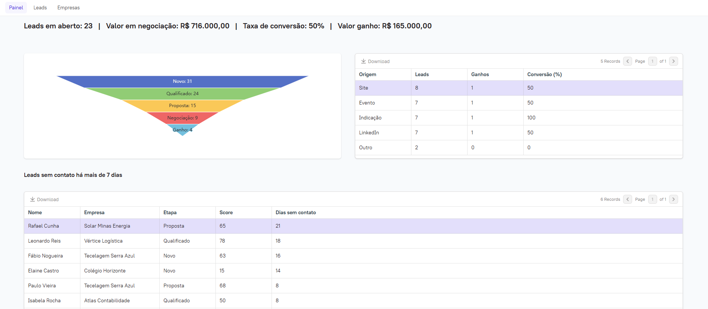
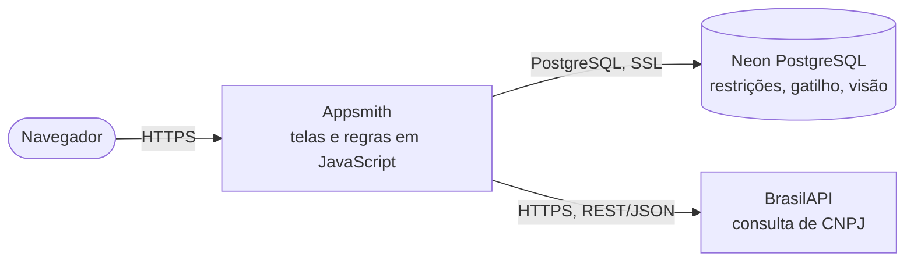

<h1 align="center">Funil de Leads</h1>

<p align="center"><b>Sistema web low-code que ajuda equipes comerciais a acompanhar cada lead do primeiro contato ao fechamento, com regras de funil, score de prioridade e indicadores de conversão.</b></p>

<p align="center">
  
  
  
  
  
  
</p>

<p align="center">
  <a href="#sobre">Sobre</a> •
  <a href="#funcionalidades">Funcionalidades</a> •
  <a href="#tecnologias">Tecnologias</a> •
  <a href="#arquitetura">Arquitetura</a> •
  <a href="#como-rodar">Como rodar</a> •
  <a href="#testes">Testes</a> •
  <a href="#documentação">Documentação</a>
</p>

<p align="center"></p>

<p align="center"><a href="https://app.appsmith.com/app/funil-de-leads/painel-6ac7e6f87cdd178ba398507c"><b>Abrir o app publicado</b></a> (dados fictícios; o primeiro carregamento pode levar alguns segundos)</p>

---

## Sobre

Equipes comerciais pequenas costumam controlar leads em planilhas. Nelas, o mesmo contato aparece duas vezes, ninguém sabe quando foi o último contato e é difícil responder "quantos leads viraram venda".

O Funil de Leads organiza empresas, contatos e interações, controla a passagem pelas seis etapas do funil com regras de negócio e mostra um painel para priorizar o trabalho. É um projeto individual de portfólio de Filipe Lorenzato (Ciência da Computação, PUC Minas).

## Funcionalidades

- **Cadastrar e editar leads.** Bloqueia e-mail repetido e telefone inválido, e mostra mensagens em português.
- **Buscar e filtrar leads.** A busca procura por nome, empresa ou e-mail; os filtros são por etapa e origem.
- **Registrar interações.** Ligação, e-mail, reunião ou mensagem, com data e descrição.
- **Avançar o lead no funil, uma etapa por vez.** Só avança quem tem interação registrada, e a partir de Proposta o valor precisa estar preenchido.
- **Marcar um lead como perdido.** O motivo é obrigatório e fica guardado.
- **Priorizar pelo score de 0 a 100.** O score é calculado pela origem, cargo, valor, telefone e número de interações.
- **Cadastrar empresas só com o CNPJ.** Razão social, atividade, cidade e situação vêm da Receita Federal pela BrasilAPI.
- **Acompanhar o painel.** Mostra leads em aberto, valor em negociação, taxa de conversão, funil de conversão, conversão por origem e leads sem contato há mais de 7 dias.

## Tecnologias

| Camada | Tecnologias |
|---|---|
| Telas e regras | Appsmith Cloud (componentes, consultas SQL parametrizadas, objetos JavaScript) |
| Banco de dados | PostgreSQL 18 no Neon, com restrições `CHECK`, índice único, chaves estrangeiras, gatilho e visão |
| Integração | BrasilAPI (REST/JSON): consulta de CNPJ |
| Testes | `node:test` (Node.js 22) para as regras em JavaScript; script SQL para as regras do banco |

## Arquitetura



O Appsmith executa as consultas a partir dos seus servidores. As regras críticas existem em duas camadas: o JavaScript avisa o usuário antes de gravar, e o banco garante a regra mesmo que o dado venha de outro lugar.

Detalhes em [docs/03-arquitetura.md](docs/03-arquitetura.md) e nas [decisões de arquitetura](docs/adr/).

## Como rodar

### Pré-requisitos

- Conta gratuita no [Neon](https://neon.com).
- Conta gratuita no [Appsmith Cloud](https://app.appsmith.com).
- Node.js 22, só para rodar os testes automatizados.

### Passo a passo

1. Clonar o repositório:
   ```bash
   git clone https://github.com/FilipeLorenzato/funil-de-leads.git
   cd funil-de-leads
   ```
2. No Neon, criar um projeto na região **AWS US East 2 (Ohio)**. No **SQL Editor**, rodar [`banco/01_estrutura.sql`](banco/01_estrutura.sql) e depois [`banco/02_dados_exemplo.sql`](banco/02_dados_exemplo.sql), que carrega 10 empresas e 30 leads fictícios.
3. No Neon, em **Connect**, desligar *connection pooling* e anotar host, banco, usuário e senha.
4. Importar o app: na tela inicial do Appsmith, *Create new → Import*, escolher [`appsmith/funil-de-leads.json`](appsmith/funil-de-leads.json) e completar a fonte de dados `BancoFunil` com os dados do passo 3.

O passo a passo completo e os problemas comuns estão em [docs/06-ambiente-e-deploy.md](docs/06-ambiente-e-deploy.md).

> [!NOTE]
> A senha do banco fica apenas na fonte de dados do Appsmith, que a guarda criptografada. Nenhuma credencial está neste repositório.

## Testes

Regras em JavaScript (score, validações, funil, CNPJ), sem dependências:

```bash
node --test
```

Regras do banco (restrições, gatilho, cascata). O script roda dentro de uma transação e desfaz tudo no final:

```bash
psql "$DATABASE_URL" -f testes/banco.sql
```

Na última execução, os 6 testes em JavaScript e as 15 verificações do banco foram aprovados. O roteiro de teste manual pela interface está em [docs/07-testes.md](docs/07-testes.md).

## Documentação

| Documento | Conteúdo |
|---|---|
| [Visão geral](docs/01-visao-geral.md) | Problema, usuários e escopo |
| [Requisitos](docs/02-requisitos.md) | Requisitos funcionais e não funcionais, e as 13 regras de negócio |
| [Arquitetura](docs/03-arquitetura.md) | Diagramas C4, camadas e o fluxo de avanço no funil |
| [Modelo de dados](docs/04-modelo-de-dados.md) | Diagrama ER e dicionário de dados |
| [Integração com a BrasilAPI](docs/05-integracao-brasilapi.md) | Chamada, campos usados e erros tratados |
| [Ambiente e publicação](docs/06-ambiente-e-deploy.md) | Como montar no Neon e no Appsmith |
| [Testes](docs/07-testes.md) | Testes automatizados e roteiro manual |
| [Decisões (ADRs)](docs/adr/) | Por que Appsmith + PostgreSQL, regras em duas camadas e histórico por gatilho |

## Estrutura de pastas

<details>
<summary>Ver estrutura</summary>

```
funil-de-leads/
├── appsmith/
│   ├── funil-de-leads.json  # app exportado do Appsmith (sem credenciais)
│   ├── RegrasLead.js        # objeto JS da página Leads (score, validação, funil)
│   ├── RegrasEmpresa.js     # objeto JS da página Empresas (CNPJ, BrasilAPI)
│   └── consultas/           # SQL de cada consulta do Appsmith, por página
├── banco/
│   ├── 01_estrutura.sql     # tabelas, restrições, gatilho e visão
│   └── 02_dados_exemplo.sql # 10 empresas e 30 leads fictícios
├── docs/                    # documentação técnica e ADRs
└── testes/
    ├── regras.test.mjs      # testes das regras em JavaScript
    └── banco.sql            # testes das regras do banco
```
</details>

## Licença

Projeto de portfólio, sem licença definida.

## Contato

**Filipe Lorenzato** · [LinkedIn](https://www.linkedin.com/in/filipelorenzato) · [GitHub](https://github.com/FilipeLorenzato)
