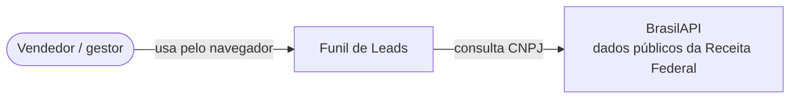
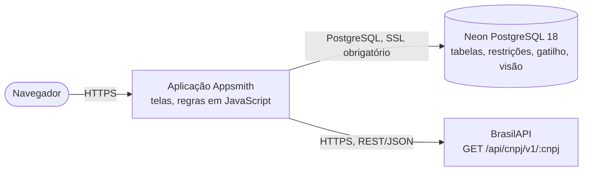
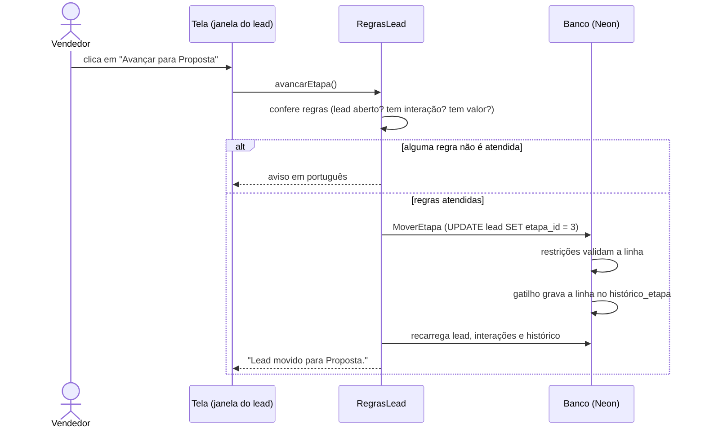

# Arquitetura

## Contexto (C4 nível 1)

O vendedor e o gestor usam o sistema pelo navegador. O único sistema externo é a BrasilAPI, consultada para trazer os dados de uma empresa a partir do CNPJ.

## Containers (C4 nível 2)

| Container | Tecnologia | Responsabilidade |
|---|---|---|
| Aplicação | Appsmith Cloud | Telas (Painel, Leads, Empresas), consultas SQL parametrizadas, regras de negócio em JavaScript e chamada à API. |
| Banco | PostgreSQL 18 no Neon (região AWS US East 2) | Guarda os dados e garante as regras críticas com restrições, chaves estrangeiras e um gatilho. |
| BrasilAPI | API REST pública | Devolve razão social, nome fantasia, atividade, cidade, UF e situação cadastral de um CNPJ. |

As consultas ao banco e à API saem do servidor do Appsmith, e não do navegador. Por isso o banco foi criado na mesma região dos servidores do Appsmith Cloud, o que reduz o tempo de cada consulta.

## Camadas da aplicação

| Camada | Onde fica | Responsabilidade |
|---|---|---|
| Tela | Componentes do Appsmith (tabelas, campos, janelas) | Mostrar dados e capturar ações do usuário. Não contém regra de negócio. |
| Regras | Objetos JS `RegrasLead` e `RegrasEmpresa` ([`appsmith/`](../appsmith/)) | Validar, calcular score, decidir se o lead pode mudar de etapa, orquestrar as consultas e traduzir erros. |
| Acesso a dados | Consultas SQL e API ([`appsmith/consultas/`](../appsmith/consultas/)) | Ler e gravar no banco com parâmetros; chamar a BrasilAPI. |
| Banco | [`banco/01_estrutura.sql`](../banco/01_estrutura.sql) | Integridade: restrições, chaves estrangeiras, histórico automático e a visão `vw_lead`. |

As regras importantes existem em duas camadas de propósito: o JavaScript dá a mensagem certa para o usuário antes de gravar, e o banco garante a regra mesmo se o dado vier de outro lugar. Ver [ADR 0002](adr/0002-regras-em-duas-camadas.md).

## Fluxo principal: avançar um lead no funil

## Decisões

- [0001. Usar Appsmith com PostgreSQL (Neon)](adr/0001-appsmith-com-postgresql.md)
- [0002. Manter as regras críticas no JavaScript e no banco](adr/0002-regras-em-duas-camadas.md)
- [0003. Registrar o histórico de etapas com um gatilho](adr/0003-historico-por-gatilho.md)
