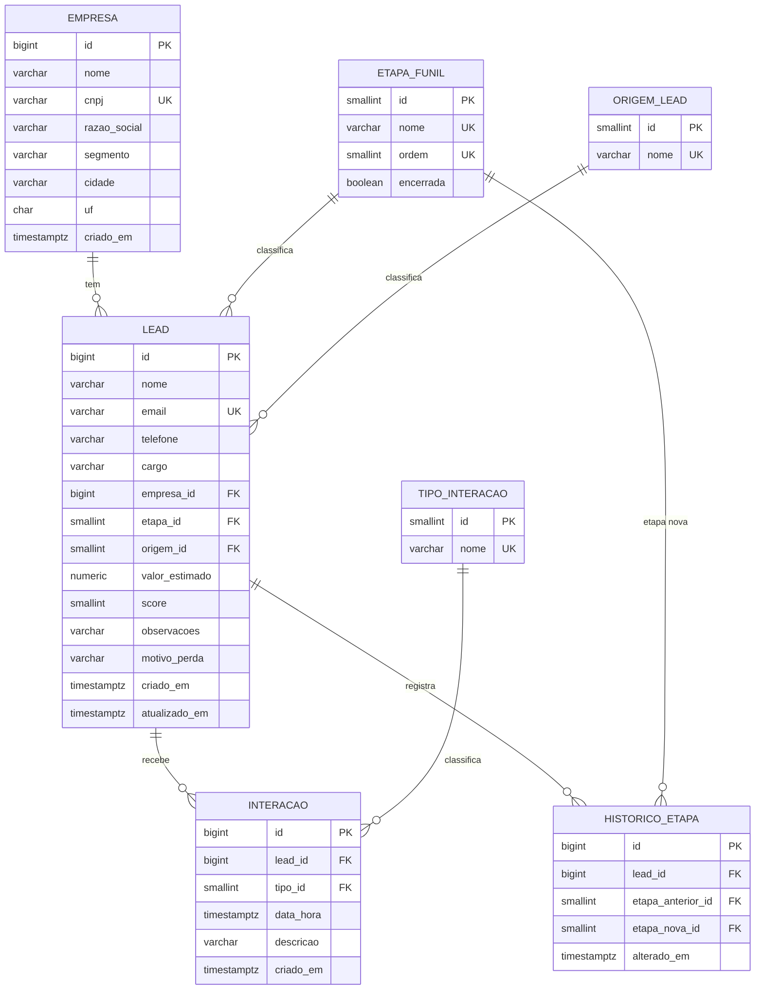

# Modelo de dados

Script completo: [`banco/01_estrutura.sql`](../banco/01_estrutura.sql). Dados de exemplo: [`banco/02_dados_exemplo.sql`](../banco/02_dados_exemplo.sql).

## Diagrama

## Listas fixas

São tabelas, e não texto solto no lead, porque as regras dependem delas e porque assim o banco recusa valores inventados.

| Tabela | Valores |
|---|---|
| `etapa_funil` | 1 Novo, 2 Qualificado, 3 Proposta, 4 Negociação, 5 Ganho (encerrada), 6 Perdido (encerrada) |
| `origem_lead` | 1 Site, 2 Indicação, 3 Evento, 4 LinkedIn, 5 Outro |
| `tipo_interacao` | 1 Ligação, 2 E-mail, 3 Reunião, 4 Mensagem |

## Dicionário de dados

### empresa

| Coluna | Tipo | Nulo? | Chave/Restrição | Descrição |
|---|---|---|---|---|
| id | bigint | não | PK, identidade | Identificador. |
| nome | varchar(100) | não | | Nome usado nas telas (nome fantasia ou razão social). |
| cnpj | varchar(14) | não | único; só 14 dígitos | CNPJ sem máscara. A máscara é aplicada na tela. |
| razao_social | varchar(150) | sim | | Razão social na Receita. |
| segmento | varchar(150) | sim | | Atividade principal (CNAE). |
| cidade | varchar(60) | sim | | Município. |
| uf | char(2) | sim | duas letras maiúsculas | Estado. |
| criado_em | timestamptz | não | padrão `now()` | Data do cadastro. |

### lead

| Coluna | Tipo | Nulo? | Chave/Restrição | Descrição |
|---|---|---|---|---|
| id | bigint | não | PK, identidade | Identificador. |
| nome | varchar(100) | não | | Nome do contato. |
| email | varchar(150) | não | único sem diferenciar maiúsculas; formato de e-mail | E-mail do contato. |
| telefone | varchar(20) | sim | | Telefone como digitado. |
| cargo | varchar(60) | sim | | Cargo; influencia o score. |
| empresa_id | bigint | não | FK → empresa, `ON DELETE RESTRICT` | Empresa do contato. |
| etapa_id | smallint | não | FK → etapa_funil, padrão 1 | Etapa atual. |
| origem_id | smallint | não | FK → origem_lead | De onde o lead veio. |
| valor_estimado | numeric(12,2) | não | ≥ 0; > 0 se Ganho | Valor do negócio. |
| score | smallint | não | entre 0 e 100 | Prioridade calculada. |
| observacoes | varchar(500) | sim | | Texto livre. |
| motivo_perda | varchar(200) | sim | obrigatório se Perdido | Por que o negócio não aconteceu. |
| criado_em | timestamptz | não | padrão `now()` | Data do cadastro. |
| atualizado_em | timestamptz | não | padrão `now()` | Última alteração. |

### interacao

| Coluna | Tipo | Nulo? | Chave/Restrição | Descrição |
|---|---|---|---|---|
| id | bigint | não | PK, identidade | Identificador. |
| lead_id | bigint | não | FK → lead, `ON DELETE CASCADE` | Lead contatado. |
| tipo_id | smallint | não | FK → tipo_interacao | Ligação, e-mail, reunião ou mensagem. |
| data_hora | timestamptz | não | padrão `now()` | Quando o contato aconteceu. |
| descricao | varchar(500) | não | não pode ser vazia | O que foi conversado. |
| criado_em | timestamptz | não | padrão `now()` | Data do registro. |

### historico_etapa

| Coluna | Tipo | Nulo? | Chave/Restrição | Descrição |
|---|---|---|---|---|
| id | bigint | não | PK, identidade | Identificador. |
| lead_id | bigint | não | FK → lead, `ON DELETE CASCADE` | Lead que mudou. |
| etapa_anterior_id | smallint | sim | FK → etapa_funil | Etapa de antes (nula na criação). |
| etapa_nova_id | smallint | não | FK → etapa_funil | Etapa nova. |
| alterado_em | timestamptz | não | padrão `now()` | Quando mudou. |

Preenchida apenas pelo gatilho `lead_historico_etapa` (função `registrar_mudanca_de_etapa`), em toda inserção de lead e em toda alteração de `etapa_id`. Ver [ADR 0003](adr/0003-historico-por-gatilho.md).

## Visão `vw_lead`

Junta o lead com os nomes de empresa, etapa e origem e com o resumo das interações (`total_interacoes`, `ultima_interacao`). As telas consultam a visão em vez de repetir os mesmos `JOIN`s.

## Índices

| Índice | Colunas | Para quê |
|---|---|---|
| `lead_email_unico` | `lower(email)` | Bloquear e-mail repetido sem diferenciar maiúsculas. |
| `lead_etapa_idx` | `etapa_id` | Filtro por etapa e indicadores. |
| `lead_empresa_idx` | `empresa_id` | Junção com empresa. |
| `interacao_lead_idx` | `lead_id, data_hora DESC` | Histórico de contatos de um lead. |
| `historico_lead_idx` | `lead_id, alterado_em` | Histórico de etapas de um lead. |

## Como alterar o modelo

O projeto não usa ferramenta de migração. `01_estrutura.sql` recria tudo do zero (apaga e cria), então qualquer mudança de estrutura entra nele e é aplicada rodando de novo os dois scripts, o que também restaura os dados de exemplo.
